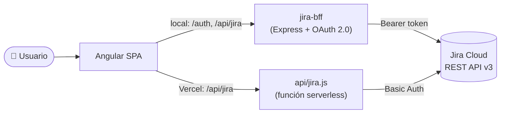

<div align="center">

# 📊 Tablero de Seguimiento de Proyecto

**Flockit AI Day 2026**

El estado real de tu proyecto en Jira, en una sola pantalla.
Sin status reports armados a mano, sin planillas, sin abrir Jira.

[](https://angular.dev)
[](https://material.angular.dev)
[](https://developer.atlassian.com/cloud/jira/platform/rest/v3/)
[](https://jira-dashboard-virid.vercel.app)

### [🚀 Ver la app en vivo](https://jira-dashboard-virid.vercel.app)

</div>

---

## 🎯 El challenge

> **Tablero de seguimiento de proyecto:** centralizar el estado de un proyecto (tareas, pendientes, ítems relevados) reemplazando el status report que se arma a mano cada semana.

Los equipos pierden horas consolidando información de Jira en PowerPoints y Excels que quedan desactualizados apenas se envían. Este tablero se conecta directo a **Jira Cloud** y muestra una vista viva del proyecto que cualquier stakeholder puede consultar en cualquier momento.

## ✨ Qué muestra

### 🏠 Dashboard
La foto del proyecto de un vistazo.
- **KPIs** — total de tareas, completadas, en curso y por hacer
- **Progreso del proyecto** — barra de avance con los hitos (Diseño UX → Dev → Integración → QA → Go-live)
- **Tabla de tareas** con clave, estado, responsable, prioridad y vencimiento, filtrable por estado
- **Pendientes de resolución** — bloqueos externos ordenados por urgencia
- **Últimas actualizaciones** — feed de actividad del equipo

### ✅ Tareas
El backlog completo, fácil de recorrer.
- Búsqueda por **resumen, clave o responsable**
- Filtros combinables por **estado** y **tipo**
- Prioridades y vencimientos destacados visualmente

### 📈 Reportes
Métricas para la reunión de seguimiento.
- **Estado del sprint** — tiempo transcurrido vs. tareas completadas
- **Distribución** por estado, prioridad y tipo
- **Carga de trabajo por miembro** del equipo

## 🔌 Tres formas de conectarse

La app detecta sola cómo conectarse a Jira al iniciar:

| Modo | Cuándo se usa | Cómo funciona |
|------|---------------|---------------|
| 🔐 **OAuth 2.0** | Desarrollo local con el BFF corriendo | Cada usuario inicia sesión con su cuenta Atlassian. El token vive en una cookie `HttpOnly` del servidor. |
| 🔑 **API Token** | Producción en Vercel | Una función serverless agrega las credenciales desde variables de entorno del servidor. |
| 🧪 **Mock** | Sin Jira configurado | Datos de prueba realistas para demos, sin ninguna configuración. |

> 🛡️ **Las credenciales de Jira nunca llegan al navegador.** En todos los modos, las llamadas pasan por un proxy del lado servidor que agrega la autenticación.

## 🏗️ Arquitectura



```
Flock-IA-Luz/
├── jira-dashboard/            # 🅰️ Frontend Angular (se deploya en Vercel)
│   ├── api/jira.js            #    Proxy serverless hacia Jira
│   ├── scripts/set-env.js     #    Genera la config de producción en el build
│   ├── src/app/
│   │   ├── core/              #    Servicios (Jira, Auth), modelos y guards
│   │   ├── login/             #    Pantalla de ingreso
│   │   ├── dashboard/         #    Vista principal
│   │   ├── tasks/             #    Listado de tareas
│   │   └── reports/           #    Reportes y métricas
│   └── vercel.json
└── jira-bff/                  # 🔐 Backend for Frontend con OAuth 2.0 (desarrollo local)
    └── server.js
```

**Stack:** Angular 22 (standalone components + signals) · Angular Material · RxJS · SCSS · Express · Vercel Functions · Jira REST API v3

## 🚀 Correrlo en local

**Requisitos:** Node.js 20+ y una cuenta de Jira Cloud (opcional: sin Jira funciona en modo mock).

### 1. Backend (OAuth)

```bash
cd jira-bff
npm install
```

Creá `jira-bff/.env` con los datos de tu app de [Atlassian Developer Console](https://developer.atlassian.com/console/myapps/):

```env
CLIENT_ID=tu-client-id
CLIENT_SECRET=tu-client-secret
SESSION_SECRET=un-string-aleatorio-largo
REDIRECT_URI=http://localhost:3001/auth/callback
FRONTEND_URL=http://localhost:4200
```

```bash
npm start            # → http://localhost:3001
```

### 2. Frontend

```bash
cd jira-dashboard
npm install --legacy-peer-deps
npm start            # → http://localhost:4200
```

Abrí http://localhost:4200 e ingresá con **Atlassian** para ver tus datos reales, o con el usuario demo para ver datos de prueba.

## ☁️ Deploy en Vercel

El proyecto de Vercel apunta a la carpeta `jira-dashboard`. Configurá estas variables en **Settings → Environment Variables**:

| Variable | Descripción |
|----------|-------------|
| `JIRA_BASE_URL` | `https://tu-org.atlassian.net` |
| `JIRA_EMAIL` | Email de la cuenta de Jira |
| `JIRA_API_TOKEN` | Token generado en [id.atlassian.com](https://id.atlassian.com/manage/api-tokens) |
| `JIRA_PROJECT` | Clave del proyecto (ej: `SCRUM`) |
| `APP_USER` / `APP_PASS` | Usuario y contraseña del login del tablero |

> También se aceptan los nombres en camelCase (`baseUrl`, `email`, `apiToken`, `projectKey`).

```bash
cd jira-dashboard
vercel deploy --prod
```

Para verificar la conexión, abrí `https://<tu-app>.vercel.app/api/jira/rest/api/3/myself`: si devuelve tu usuario de Jira, está todo funcionando.

## 🔒 Seguridad

- ✅ El token de Jira y el email **no se incluyen** en el código que descarga el navegador.
- ✅ `environment.ts` y `.env` están en `.gitignore` y `.vercelignore`.
- ✅ En modo OAuth la sesión viaja en una cookie `HttpOnly` con protección CSRF en el login.
- ⚠️ El login de usuario/contraseña del tablero se valida en el navegador: sirve como barrera simple para demos, no como control de acceso real.

---

<div align="center">

Hecho con 💙 y 🤖 por **Luz Cuello** durante el **Flockit AI Day 2026**

</div>
